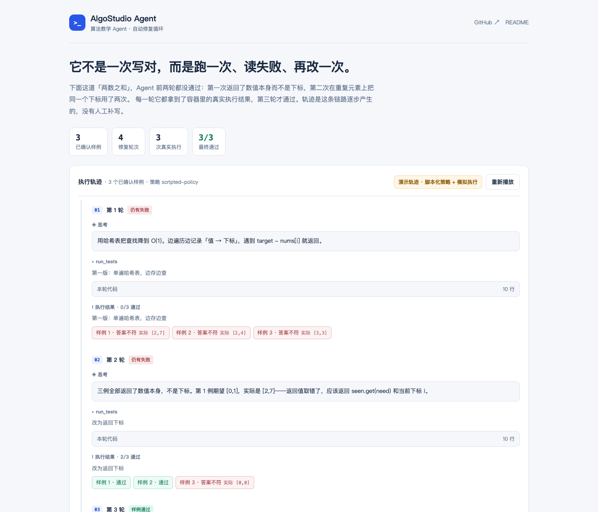
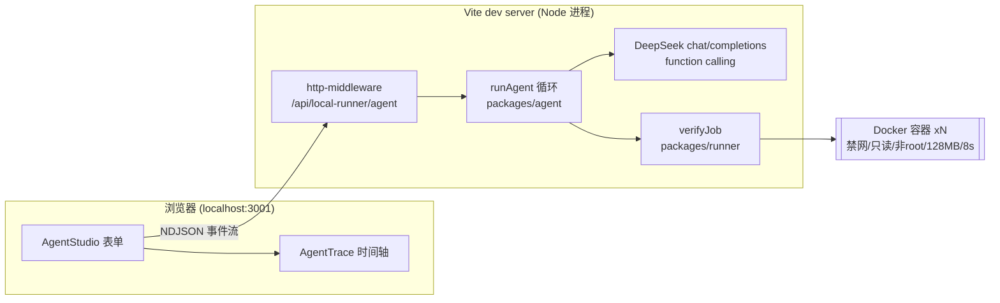

# AlgoStudio · 算法教学 Agent（自动修复循环）

> 给它一道题和几条人工核对的样例，它自己写代码、在禁网沙箱里跑、读失败用例、修改、再跑——直到通过或用尽轮次。**「通过」两个字由执行器判定，模型无权宣布。**

[](./.github/workflows/ci.yml)
[](./LICENSE)

**在线看交互（无需装任何东西）**：[轨迹回放演示页](./docs/demo/index.html) · 仓库内的[演示轨迹数据](./docs/demo/agent-demo.json)



> 截图为静态回放页（脚本化策略 + 模拟执行，页面有明确标注）。真实运行的动图待录：`pnpm dev` 后打开 http://localhost:3001，切到「Agent 解题」点「开始运行」，录 8–12 秒即可。

---

## 1. 这是什么

一个运行在本地、面向算法教学场景的**受限解题 Agent**：

| 能力 | 说明 |
|------|------|
| 解题循环 | `写实现 → run_tests → 读失败用例 → 修改 → 再跑`，默认最多 4 轮 |
| 真实执行反馈 | 每个样例在独立 Docker 容器中运行（禁网、只读、非 root、128 MB、8 秒/例），逐例返回真实结果 |
| 工具调用协议 | 模型只有两个工具：`run_tests` 与 `finish`；参数不合法会被作为「观察」返回给模型自行修复，而不是中断 |
| 轨迹可视化 | 每一轮的思考、工具调用、逐例结果、修复依据，全程流式渲染 |
| 教学 | 通过后输出讲题文本：思路、逐步推演、复杂度、边界注意事项 |

它**不是**：

- ❌ 不是自主 Agent——没有联网搜索、没有自由文件访问、工具面只有两个；
- ❌ 不宣称"验证通过 = 解法正确"——只验证你确认过的 1–8 条样例；
- ❌ 不是多租户沙箱——这是本地单用户的教学演示，宿主控制器仍能访问 Docker daemon。

这些边界写在代码和文档里，也写在页面上的状态徽章里。

原有能力保留：「直接讲题」把任意题目文本直接讲明白；「两道示例课件」提供两数之和与无重复字符最长子串的动画课件。Agent 不改变它们的语义。

## 2. 快速开始

```bash
git clone https://github.com/minhuifang/qwen-interactive-tutor-agent
cd qwen-interactive-tutor-agent

# 1) 依赖（Node >= 22.18，推荐 pnpm）
pnpm install

# 2) 模型密钥（DeepSeek）
cp .env.example apps/web/.env.local
#    编辑 apps/web/.env.local，填入 DEEPSEEK_API_KEY

# 3) 隔离执行器（macOS + Colima，一次性配置见 docs/runner-setup.md）
colima start tutor-sandbox

# 4) 启动（端口固定 3001，被占用时报错而不是自动递增）
pnpm dev            # http://localhost:3001
```

打开页面后默认进入 **Agent 解题**：题目与三条样例已预填，勾选确认，点「开始运行」。

没有 Docker / 没有密钥时，页面会自动退化为**轨迹回放**（数据由真实循环代码 + 脚本化策略生成，页面明确标注为演示），交互与协议完全一致。

## 3. 架构



### 3.1 模型能做什么、不能做什么

| 工具 | 模型可以 | 模型不可以 |
|------|---------|-----------|
| `run_tests { code, note }` | 提交一份 `solve(input)` 实现并拿到逐例结果 | 修改样例、选择只跑部分用例、得到任何未执行的信息 |
| `finish { code, approach, ... }` | 提交最终答案与讲题 | 声称"已通过"——若提交代码与上次执行的不一致，系统自动补跑一次，以执行器为准 |

### 3.2 终止条件

| 条件 | 最终状态 | 说明 |
|------|---------|------|
| `finish` 且执行器确认通过 | `examples_passed` | 提交代码与被验证代码哈希一致 |
| 轮次用尽 | `round_limit` | 返回最后一次执行结果，如实标注 |
| 执行器连续两次不可用 | `blocked` | 不空转、不烧额度 |
| 模型调用超预算 | `budget_limit` | 默认 8 次调用/任务 |
| 用户停止 | `cancelled` | 已收到的事件保留 |

### 3.3 轨迹协议（NDJSON）

每行一个事件，浏览器端 `lib/agent-stream.ts` 与静态演示页共用同一套结构：`meta / round_start / thought / tool_call / tool_result / round_end / final / error / done`。未知行会被丢弃而不是崩溃——流是可以"部分成功"的。

## 4. 评测

```bash
# 1) 校验评测集本身：60 条样例的预期输出必须与参考实现一致
node eval/self-check.mjs

# 2) 真实评测（需要密钥 + 沙箱，花钱）
node eval/run.mjs            # 20 题，写 eval/results.json
node eval/run.mjs --limit 5  # 冒烟
```

评测集是 20 道固定题（`eval/problems.mjs`），每题 2–4 条样例；`self-check` 会先证明**评测集本身没错**——预期输出与参考实现逐条核对，fixture 写错会让构建失败，而不是悄悄拉低通过率。

当前已验证的事实：**评测集自检通过（20 题 / 60 条样例，预期输出与参考实现逐条一致）**；16 项单元与接线测试、类型检查与生产构建全绿。

> **诚实声明**：模型实测的通过率数字需要 `DEEPSEEK_API_KEY` + 本地 Docker 沙箱（`colima start tutor-sandbox`）才能产生——这两项依赖不在 CI 或本仓库中，因此我们不做没有跑过的实验声明。跑完 `eval/run.mjs` 后，把 `eval/results.json` 的摘要贴进本节即可。

## 5. 测试

```bash
node --test packages/agent/loop.test.mjs         # 循环语义：11 项
node --test packages/runner/agent-http.test.mjs  # HTTP 接线：5 项
pnpm test                                        # 全部（含原有 TS 测试）
node packages/agent/record-demo.mjs              # 重新生成演示轨迹
```

循环的关键不变量都有测试钉住：

- 模型 `finish` 未执行过的代码 → 自动补跑一次，结论仍来自执行器（`not_passed` 而非模型说的通过）；
- 执行器不可用时不继承旧结论——提交未验证代码 → `not_run`/`blocked`；
- 工具参数不合法 → 作为观察返回，循环继续，非法调用不能触达沙箱；
- 串行：一个运行未结束时拒绝第二个请求。

## 6. 安全模型（继承并扩展自原项目）

- 模型代码只作为 **stdin 数据**进入容器，在容器内求值；宿主没有 eval / VM；
- 容器参数：`--network=none --read-only --cap-drop=ALL --no-new-privileges --user=65534 --memory=128m --pids-limit=32`、8 秒墙钟、32 KiB 输出上限、镜像锁 `node@sha256:` 摘要、`--pull=never`；
- 清理失败 → 中间件进入 `blocked`，停止接受新作业，而不是带病继续；
- 接口只存在于 localhost 的 Vite 开发服务：回环 + Host/Origin + 会话令牌 + 单并发 + 每小时限额；
- 模型调用 `redirect: 'manual'`，3xx 一律拒绝，密钥不会被转发到重定向目标；
- 题目原文与工具返回值都是**不可信数据**：只进入 user/tool 消息，从不拼进 system 指令。

**Agent 化新增的一层**：`acknowledged` 的语义被拆开了。人工确认的对象是*题目与样例预期*（UI 上显式勾选），而*被执行的代码*是 Agent 自己写的——这个变化在 `http-middleware` 里有注释说明，也是本仓库与"人肉点确认"版本的核心差异。

## 7. 设计取舍

| 问题 | 选择 | 代价 |
|------|------|------|
| 循环跑在哪 | Node 中间件（与 Docker 控制器同进程），而不是 Worker | Worker 里不能 spawn；但循环逻辑与框架绑定在 dev server |
| 模型不可用/不支持工具时 | 提示模型使用工具，不中断任务 | 一轮可能被浪费在 no_tool 上 |
| 样例从哪来 | 只用人工确认的样例，模型不能自造预期 | 覆盖有限；换来"通过"两个字有意义 |
| `finish` 代码与上次执行不一致 | 自动补跑一次验证 | 多一次容器消耗；换来结论永远对应被提交的代码 |
| 轨迹在服务端流式输出 | NDJSON 逐行，未知行丢弃 | 客户端需要容忍乱序到达的渲染 |
| 演示能力 | 回放模式 + 明确的"脚本化策略 + 模拟执行"徽章 | 无法伪造也不试图伪造真实模型运行 |

## 8. Roadmap

- [ ] `run_tests` 支持模型传入**额外生成的输入**（预期仍由执行器/参考实现判定，防止自证）
- [ ] 评测接入 CI：夜间跑 5 题冒烟，把通过率写回 README
- [ ] 执行轨迹导出为可分享的 permalink（轨迹 JSON 已可序列化）
- [ ] 无序输出比较器（当前要求精确 JSON 相等）
- [ ] RAG：把题解知识库接入提示上下文

## 9. 目录

```
packages/agent/        循环、工具协议、轨迹协议、模型适配、演示录制（零依赖 ESM）
packages/runner/       Docker 执行器与本地 HTTP 桥（含 agent 端点）
apps/web/              Next(RSC/vinext) 前端：AgentStudio / AgentTrace / 讲题与课件
eval/                  20 题固定评测集 + 自检 + 真实评测脚本
tests/                 原有集成测试（含 live 检查脚本）
docs/                  架构、沙箱配置、验收记录、演示页
```

## License

[MIT](./LICENSE)
